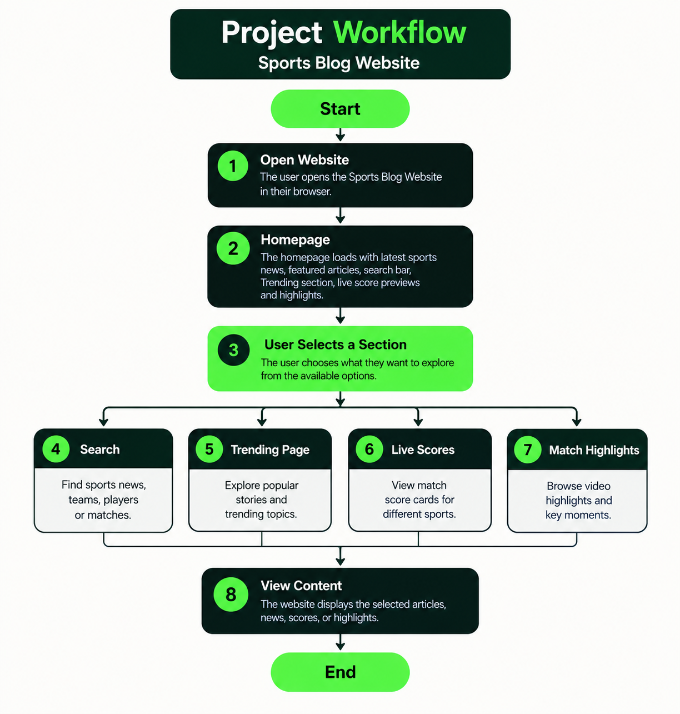
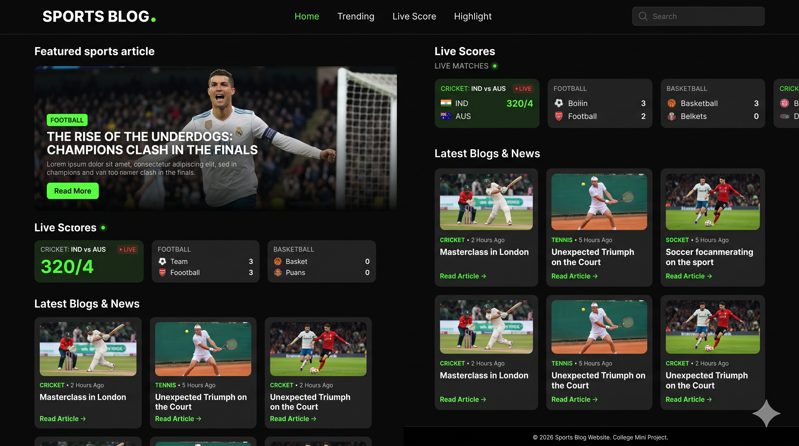
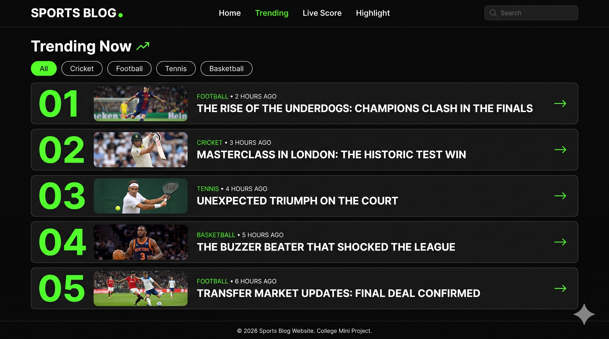
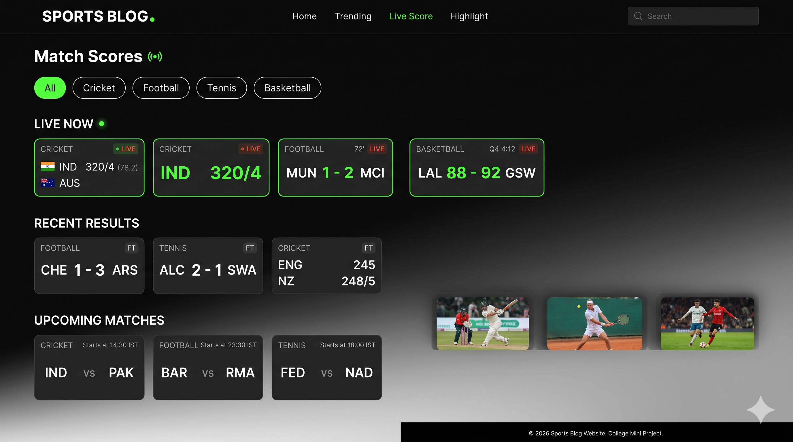
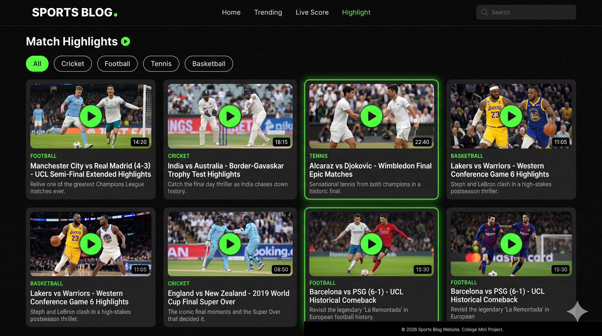

# Mini_project

# Sports Blog Website

## Project Objective

To develop a user-friendly sports blog website where users can explore sports blogs, news, articles, live score cards, trending stories, and match highlights.

## Features

- Homepage displaying sports blogs, news, articles, and live scores
- Search functionality for sports content
- Separate Trending page
- Live Score page for multiple sports
- Match Highlights page
- Parrot green, black, and white UI theme

## Workflow

### Project Workflow

## Technologies Used

- HTML
- CSS
- JavaScript
- Git and GitHub

## Project Status

College mini project — under development.

## Prototype images of the website design

### Home Page

### Trending Page

### Live Score Page

### Highlights Page

## Future Improvements

- Integrate a live sports data API
- Improve responsive design
- Add more sports news and match highlights
